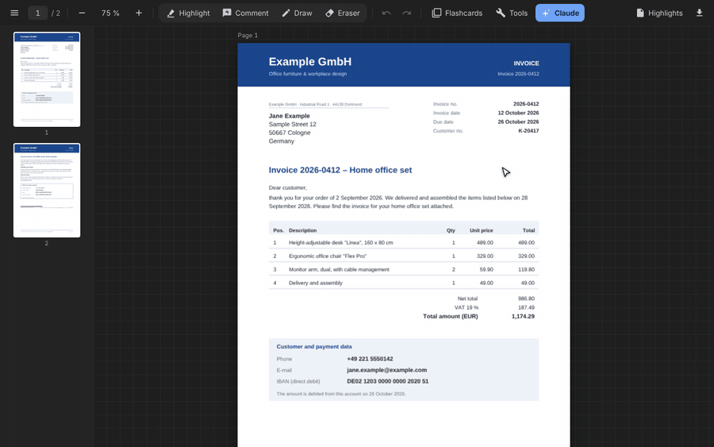
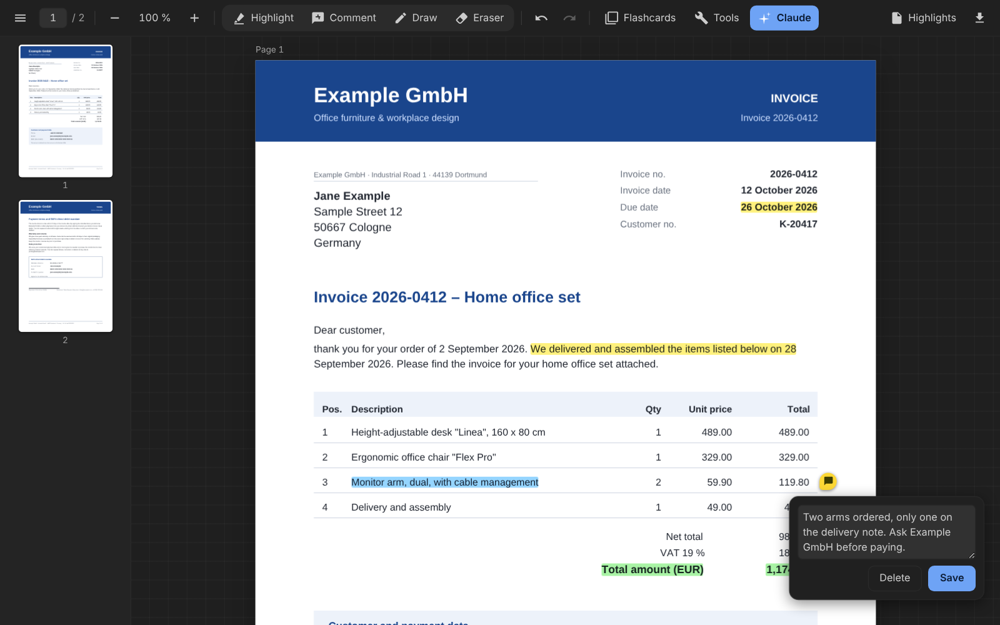
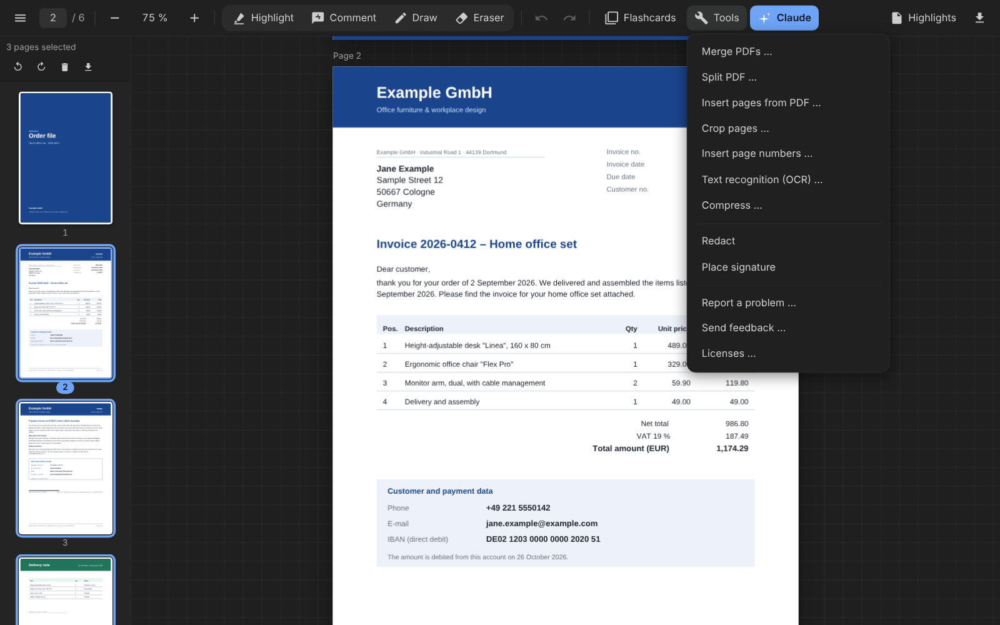
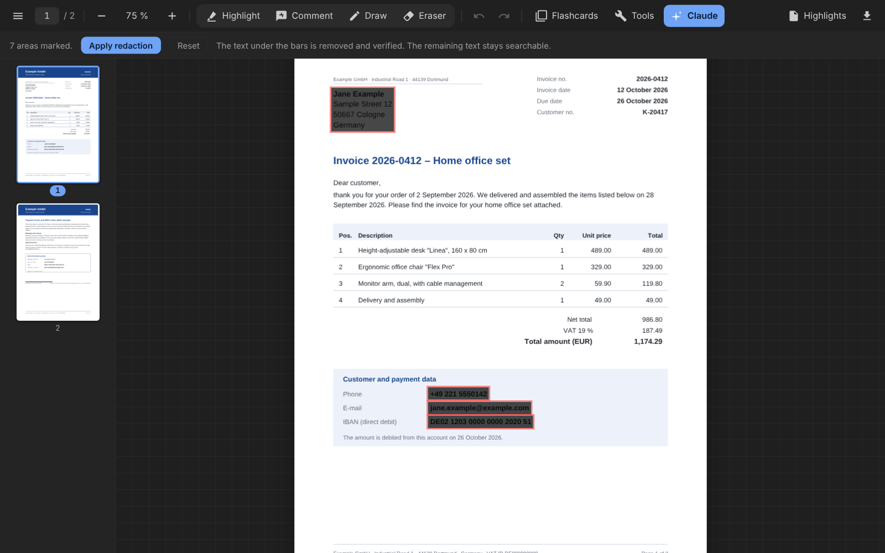
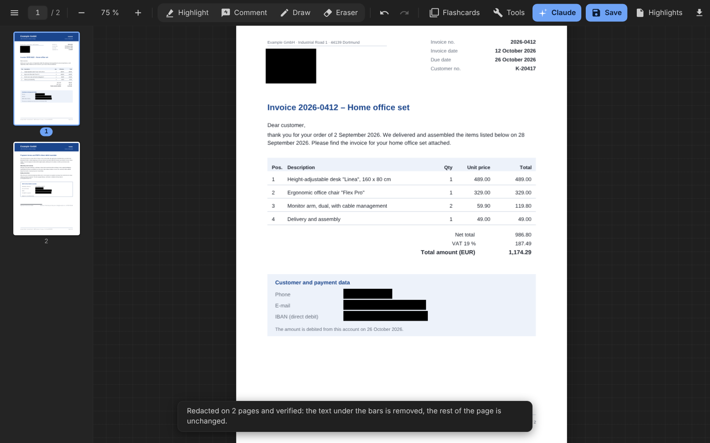
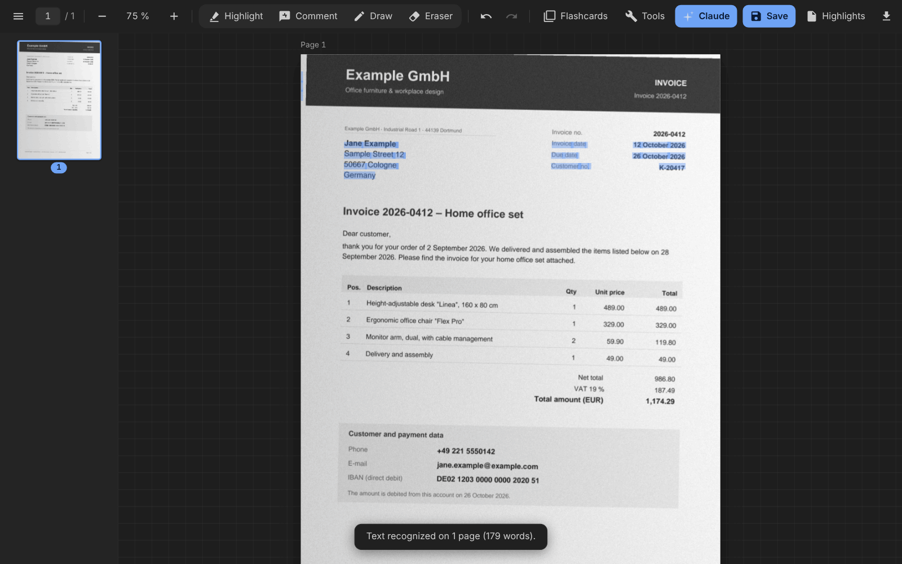
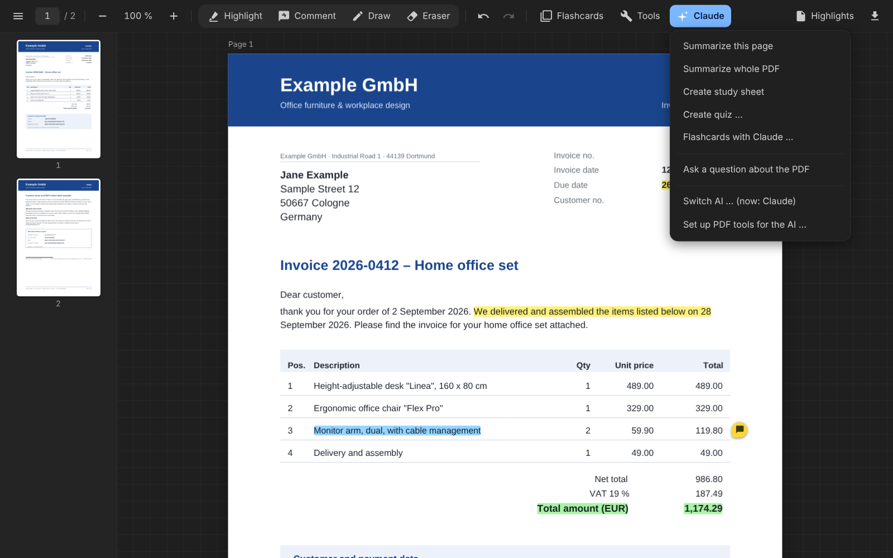

# PDF Workbench

Read, annotate, redact, merge, split and OCR PDFs in VS Code – offline, with the AI of your choice. Everything runs locally; nothing is sent without your approval.

PDF Workbench turns VS Code into a workspace for documents. Everything is stored as ordinary files in your project folder, the AI you choose can read and operate the tools, and you stay in control: the AI prepares, you review, approve and sign.

**Free and open source (Apache-2.0).** If it helps you, you can [buy me a coffee](https://buymeacoffee.com/juurpa).



| | |
|---|---|
|  |  |
|  |  |
|  |  |

*All demo documents are fictional.*

## Contents

- [At a glance](#at-a-glance)
- [Get started](#get-started)
- [Features](#features)
- [What the AI does for you](#what-the-ai-does-for-you)
- [The 22 tools for the AI](#the-22-tools-for-the-ai-mcp)
- [Choose your AI](#choose-your-ai)
- [Privacy](#privacy)
- [Where data is stored](#where-data-is-stored)
- [Roadmap](#roadmap)
- [For developers](#for-developers)
- [Support the project](#support-the-project)
- [Known limits](#known-limits)
- [License](#license)

## At a glance

| You want to … | PDF Workbench gives you |
|---|---|
| Read and mark a PDF | Viewer with highlights, underline, strike-through, comments, drawing and shapes, search, table of contents, undo/redo |
| Change the text itself | Click a line, rewrite it – the old text is removed from the file, not covered |
| Find your marks again | Highlights list: filter, jump to the passage, export to Markdown/CSV/JSON |
| Print, e-mail, save a copy | File menu with “save a copy as …”, printing, and an e-mail draft with the PDF attached |
| Reorganize pages | Rotate, delete, duplicate, reorder, extract, insert, merge, split, crop, page numbers |
| Hide sensitive data for real | Redaction that removes the text from the file, then checks the result independently |
| Make a scan searchable | Offline OCR (German and English), text sits invisibly behind the scan image |
| Fill forms, stamp, clean up | Form filling, watermarks and stamps, metadata viewer and cleaner (AI tools) |
| Let an AI do the routine work | 22 PDF tools over MCP; you review and approve |
| Arrange the toolbar your way | Drag buttons, hide what you do not need, pin any tool |
| Keep everything private | All core features run offline; nothing is sent on its own |

## What the AI does for you

The AI does not only chat about the PDF – it **operates the tools**, and every result is a new file you can check. Things you can simply ask Claude Code (or another MCP client):

| You say … | What happens | Why it is worth it |
|---|---|---|
| “Black out all names, IBANs and phone numbers in `contract.pdf`.” | The AI searches (`pdf_find`), shows you the hits, and after your OK redacts them for real (`pdf_redact`); an independent check confirms the text is gone. | Minutes instead of an hour of manual marking – and no “black box over still-copyable text” mistakes. |
| “Replace ‘Winter term 2026/27’ with ‘Summer term 2027’ everywhere.” | `pdf_replace_text` lists the lines first (dry run), then rewrites them; the old letters are deleted from the page. | Fix a typo or a date without Word, without the source file and without Acrobat. |
| “Make this scan searchable and then summarize it.” | Offline OCR (`pdf_ocr`) puts a text layer behind the scan; the AI reads it with page numbers. | Scans become usable for search, copy, redaction and AI – nothing leaves your computer. |
| “Build a study sheet / mind map from my highlights.” | The AI reads your highlights and notes (`marks.md`) and writes a Markdown file next to the PDF. | Your own selection becomes the learning material, with page references. |
| “Fill in this form with the data from `profile.md`.” | `pdf_form_fields` lists the fields, the AI proposes values, you approve, `pdf_fill_form` writes a new PDF. | Repetitive office forms in seconds; passwords and ID numbers are never filled in on its own. |
| “What changed between version 1 and version 2?” | `pdf_compare` matches the pages, lists the changed words per page and writes a report. | Contract and script versions checked in one step. |
| “Merge these three PDFs, add page numbers, remove the metadata, compress.” | A chain of page tools, each writing a new file. | A whole “prepare for sending” routine with one sentence. |

The rules stay the same for every task: originals are never overwritten, redaction and editing are verified, and signing and sending are always done by you.

## Get started

1. **Install.** PDF Workbench is not on the VS Code Marketplace yet. Install the `.vsix` file: `code --install-extension pdf-workbench-<version>.vsix`, or in VS Code open Extensions, then the `…` menu, then *Install from VSIX…*. To build the file yourself, see [For developers](#for-developers).
2. **Open a PDF.** PDF files open in PDF Workbench by default (viewer, markings, page tools in the toolbar).
3. **Optional, for AI help:** run **PDF Workbench: Set up PDF tools for AI (MCP)**. It writes a `.mcp.json` into your folder so Claude Code (or another MCP client) can use the tools.
4. **Optional:** run **PDF Workbench: Choose AI provider** to pick Claude Code, copy-only, or an OpenAI-compatible service such as a local Ollama.

## Features

### Reading and annotating
- Highlight, underline or strike through text; click a highlight to change its color or kind, add a note, copy it or let the AI explain it
- Comments (movable), drawing, highlighter pen for scans, shapes (line, arrow, rectangle, ellipse), eraser with adjustable size and “clear this page”
- Sidebar with tabs: page thumbnails, **highlights list** (filter by kind and color, click to jump to the passage, export as Markdown, CSV or JSON, hand to the AI), **search** (all matches highlighted, Ctrl+F) and **table of contents**
- Dark pages for reading at night; flashcards from your highlights; undo/redo for everything, including page changes
- The file is reloaded automatically when another program or the AI changes it

### Word, PowerPoint and images
- **.docx** and **.pptx** open directly in PDF Workbench; **JPG, PNG, GIF, BMP, WebP** via right-click → *Open in PDF Workbench* (VS Code's own image preview stays the default)
- The file is turned into a PDF on your machine, offline, so every tool works on it: highlight, comment, search, redact, sign, OCR for photos of documents, the AI
- Word and PowerPoint pages carry an exact, invisible text layer (no OCR needed); images are embedded unchanged, phone photos are turned upright
- The original is never changed: **File → Save as PDF** creates a new PDF next to it

### Editing
- **Edit text:** click a line, rewrite it, press Enter. The old letters are deleted from the page code (the same engine as redaction), the new text keeps bold, italic and color of the parts you did not change, and two checks make sure no other text is lost. Scanned pages need OCR first.
- **Add text** boxes and **insert images** (move and resize them, they are burned in when you save).

### Save, print, share
- File menu: save, save as, **save a copy with annotations** (choose folder and name; burned in, or as real PDF comments that Acrobat, Edge and Preview can edit), print, e-mail, show in folder, copy path
- **Print:** prepares the PDF (with or without annotations, all or selected pages) and opens it in your PDF program
- **E-mail:** opens a draft in your mail program with the PDF attached; nothing is sent until you press Send

### Your toolbar
- Drag buttons to a new place, right-click to remove one, pin any tool from the Tools menu, choose labels (automatic, always, icons only), or use *Customize toolbar…*

### Page tools
- Rotate, delete, duplicate, reorder (drag and drop), extract and insert pages
- Merge, split, crop, add page numbers, compress

### True redaction, with verification
- The characters under a black bar are deleted from the page code itself, not just covered. Fonts, layout, links and bookmarks stay as in the original.
- The finished file is then checked independently for leftovers (page content, data streams, properties, bookmarks, metadata). Scans are run through OCR first.
- Only when this cannot be done safely (for example a photo under the bar) is the page rebuilt as an image with a text layer that omits the redacted characters.

### Built-in OCR (offline)
- Text recognition for scanned pages, fully local, German and English recognition
- Detects rotated pages, tables and forms. The scan image stays unchanged; the recognized text sits invisibly behind it, so the page becomes searchable, selectable and redactable.
- Known limits: OCR takes about 3–25 seconds per page depending on the computer. Handwriting and formulas are not recognized reliably, and scans with heavy shadows can produce errors. Pages with low confidence are reported.

### Signature (simple)
- Place an image of your signature on a PDF.
- **Please note:** this is only a *simple* electronic signature. It is **not legally equivalent to the written form** and does not replace a qualified electronic signature where one is required.

### Bug reports and feedback
- **PDF Workbench: Report a problem…** and **PDF Workbench: Send feedback…** show the complete report before anything leaves your machine. Reports never contain document content, and nothing is sent without your explicit approval.

## The 22 tools for the AI (MCP)

The command **PDF Workbench: Set up PDF tools for AI (MCP)** writes a `.mcp.json` file. Claude Code (or another MCP client) can then use these tools. Original files are never overwritten: every tool writes a new file. Signing and sending always stay with you. The MCP server runs with the Node runtime built into VS Code; you do not need to install Node.

| Group | Tools | What they do |
|---|---|---|
| Read | `pdf_info`, `pdf_read_text`, `pdf_read_marks`, `pdf_find` | Page count and properties, text by page, your highlights and comments, search (including typical personal data) |
| Redact and recognize | `pdf_redact`, `pdf_ocr` | True redaction with dry run and verification; offline OCR for scans |
| Pages | `pdf_merge`, `pdf_split`, `pdf_extract_pages`, `pdf_delete_pages`, `pdf_rotate`, `pdf_reorder`, `pdf_crop`, `pdf_number_pages` | Combine, split, pick, remove, rotate, reorder, trim margins, add page numbers |
| Size | `pdf_compress` | Light size reduction by rewriting the structure and removing metadata |
| Forms | `pdf_form_fields`, `pdf_fill_form`, `pdf_flatten_form` | List, fill and fix form fields. The AI never fills passwords or ID numbers on its own. |
| Stamp and clean | `pdf_watermark`, `pdf_metadata` | Text watermark or stamp; read, change or remove metadata before sharing |
| Edit text | `pdf_replace_text` | Rewrites every line that contains a text (dry run first); the old letters are deleted, unchanged parts keep their look |
| Compare | `pdf_compare` | Two versions of a PDF: pages are matched first, then the words; changes per page plus a Markdown report |

## Choose your AI

Run **PDF Workbench: Choose AI provider**: Claude Code (default), copy-only (the prompt goes to your clipboard and you paste it into any AI), or any OpenAI-compatible API (OpenAI, Gemini, OpenRouter, a local Ollama and others). The endpoint and model are set in the settings; the API key is stored in VS Code's SecretStorage.

## Privacy

- Everything important runs locally on your machine: PDF editing, redaction and OCR need no internet connection.
- PDF Workbench sends nothing on its own. Problem reports and feedback are created only after your explicit approval, are shown to you first, and never contain document content.
- Text goes to an AI provider only if you choose one yourself (for example Claude Code or an OpenAI-compatible API). For sensitive documents choose "copy only" or a local model such as Ollama.
- API keys are kept in VS Code's SecretStorage, not in files.

## Where data is stored

For every PDF, PDF Workbench keeps a folder `_pdf-workbench/<pdf-path>/` in your project (the folder name can be changed in the setting `pdfWorkbench.dataFolder`). It contains:
- `text.md` – the extracted text of the PDF, organized by page
- `marks.md` – your highlights and comments

The command **PDF Workbench: Add Claude Code hint to CLAUDE.md** makes sure Claude Code reads these files first.

## Roadmap

The full list is in [ROADMAP.md](ROADMAP.md). The next steps, in order:

1. **Compare two PDFs** (AI tool and side-by-side view)
2. **Table extraction** to CSV, Markdown and JSON
3. **Export to Markdown** (Word later)
4. **Image downsampling inside PDFs**, so compress really saves space
5. **Open and edit HTML, Markdown and JSON** with preview next to the source
6. **Text editing on the PDF page**
7. **Workbench Image**, a separate extension: resize and compress images, crop, strip EXIF

PDF Workbench stays 100% free. There is no paid tier and there are no license keys.

## For developers

Other extensions can register their own AI provider:

```js
const api = vscode.extensions.getExtension("juurpa.pdf-workbench").exports;
api.registerProvider({ id: "mine", label: "My provider", run: async (prompt, { signal }) => "Answer" });
```

Build and test:

```
npm install
npx @vscode/vsce package --allow-missing-repository -o pdf-workbench-X.Y.Z.vsix
code --install-extension pdf-workbench-X.Y.Z.vsix
```

How it fits together: [docs/ARCHITEKTUR.md](docs/ARCHITEKTUR.md) (in German). Status and plan: [docs/STAND-UND-PLAN.md](docs/STAND-UND-PLAN.md). Test tools: `test/tools/README.md`. Principles for every change: originals are never overwritten, anything that hides information is verified independently, no document content in logs, local first, every new dependency gets a license entry.

## Support the project

PDF Workbench is free. If it saves you time, you can support its development on [Buy Me a Coffee](https://buymeacoffee.com/juurpa). Bug reports and ideas are just as welcome: use *Report a problem…* in VS Code or open an [issue](https://github.com/Juurpa/VS-Code-Extention/issues).

## Known limits

- OCR: handwriting, formulas and scans with heavy shadows are unreliable.
- The image signature is a simple signature only, not the legal written form.
- Word/PowerPoint: the layout is drawn by a browser renderer and can differ slightly from Office (fonts that are not installed, complex SmartArt, automatic page breaks in Word files not saved by Word). Pages become images with a text layer, not editable Office text. Old .doc/.ppt files are not supported.
- Not yet on the VS Code Marketplace.

## License

Apache-2.0. Third-party licenses: see `THIRD_PARTY_LICENSES.md` (or run **PDF Workbench: Show licenses**).
