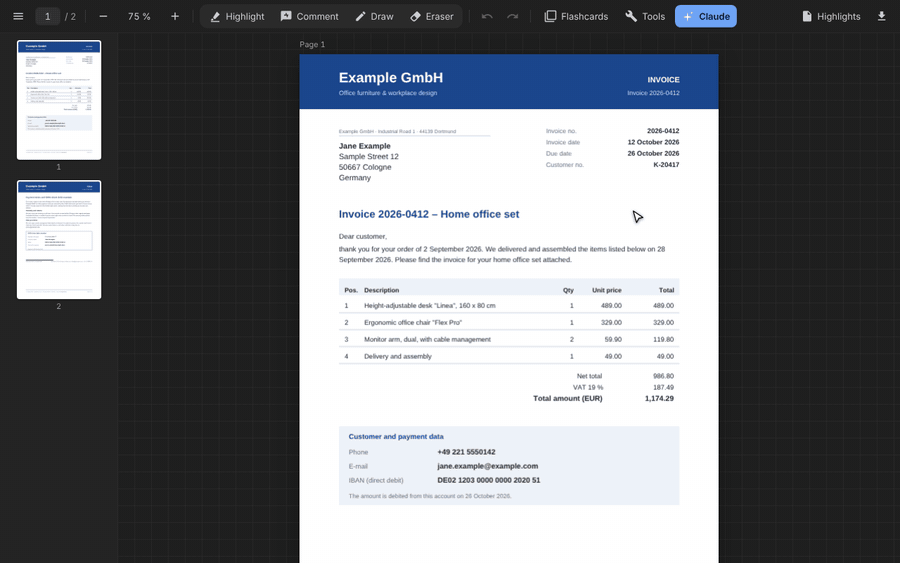
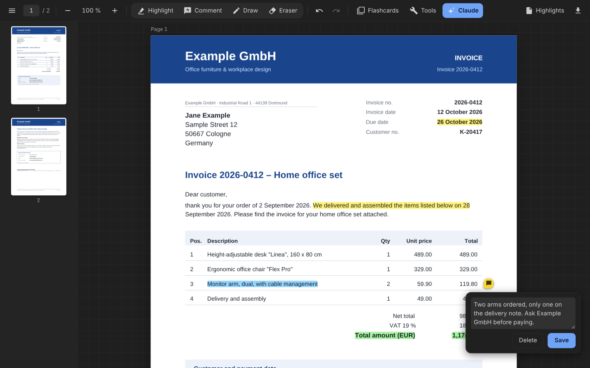
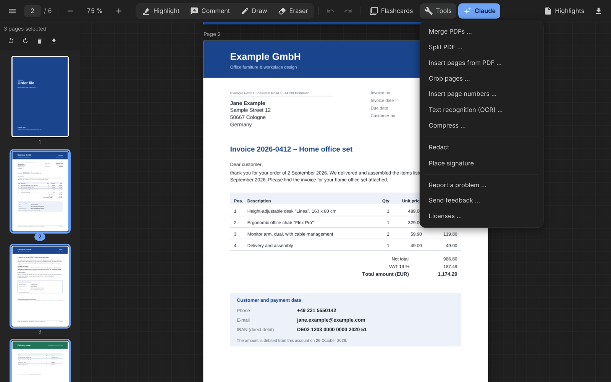
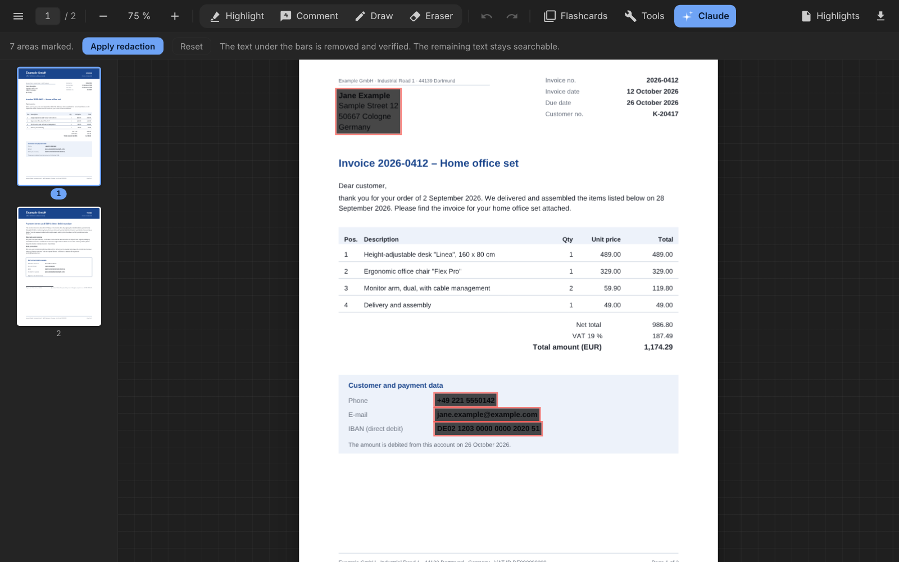
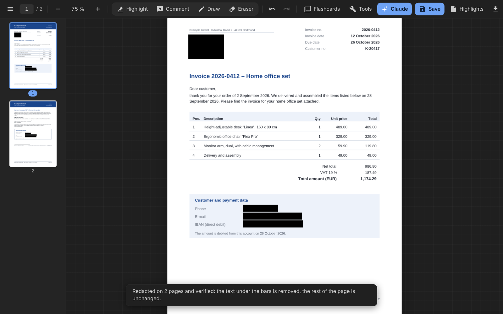
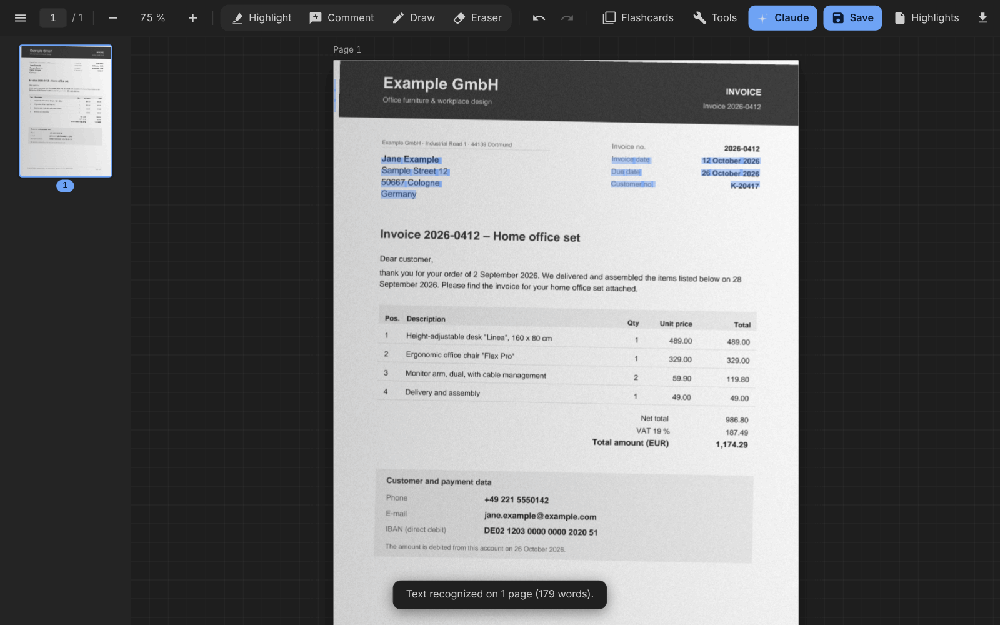
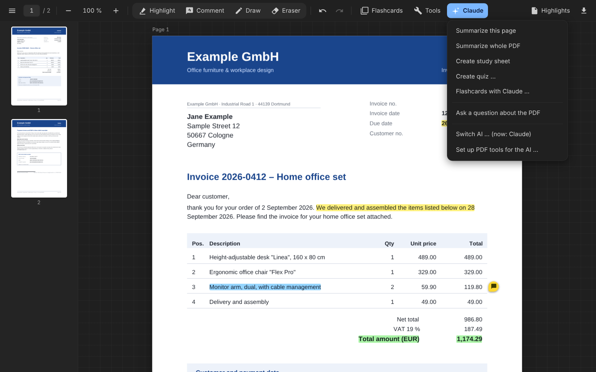

# PDF Workbench

Read, annotate, redact, merge, split and OCR PDFs in VS Code – offline, with the AI of your choice. Everything runs locally; nothing is sent without your approval.

PDF Workbench turns VS Code into a workspace for documents. Everything is stored as ordinary files in your project folder, the AI you choose can read and operate the tools, and you stay in control: the AI prepares, you review, approve and sign.



| | |
|---|---|
|  |  |
|  |  |
|  |  |

*All demo documents are fictional.*

## Features

### Reading and annotating
- Read, highlight, comment and draw on PDFs; create flashcards from your highlights
- Undo/redo, including page changes

### Page tools
- Rotate, delete, duplicate, reorder (drag and drop), extract and insert pages
- Merge, split, crop, add page numbers, compress

### True redaction, with verification
- The characters under a black bar are deleted from the page code itself, not just covered. Fonts, layout, links and bookmarks stay as in the original.
- The finished file is then checked independently for leftovers (page content, data streams, properties, bookmarks, metadata). Scans are run through OCR first.
- Only when this cannot be done safely (for example a photo under the bar) is the page rebuilt as an image with a text layer that omits the redacted characters.

### Built-in OCR (offline)
- Text recognition for scanned pages, fully local, German and English recognition
- Detects rotated pages, tables and forms. The scan image stays unchanged; the recognized text sits invisibly behind it, so the page becomes searchable, selectable and redactable.
- Known limits: OCR takes about 10–25 seconds per page. Handwriting and formulas are not recognized reliably, and scans with heavy shadows can produce errors. Pages with low confidence are reported.

### Signature (simple)
- Place an image of your signature on a PDF.
- **Please note:** this is only a *simple* electronic signature. It is **not legally equivalent to the written form** and does not replace a qualified electronic signature where one is required.

### PDF tools for the AI (MCP)
- The command **PDF Workbench: Set up PDF tools for AI (MCP)** writes a `.mcp.json` file. Claude Code (or another MCP client) can then read, search, OCR, redact, merge, split, extract, delete, reorder, rotate, crop, number and compress PDFs, list and fill form fields, add watermarks and stamps, and read, change or remove metadata.
- Original files are never overwritten: every tool writes a new file. Signing and sending always stay with you.
- The MCP server runs with the Node runtime built into VS Code; you do not need to install Node.

### Bug reports and feedback
- **PDF Workbench: Report a problem…** and **PDF Workbench: Send feedback…** show the complete report before anything leaves your machine. Reports never contain document content, and nothing is sent without your explicit approval.

## Choose your AI
Run **PDF Workbench: Choose AI provider**: Claude Code (default), copy-only (the prompt goes to your clipboard and you paste it into any AI), or any OpenAI-compatible API (OpenAI, Gemini, OpenRouter, a local Ollama and others). The endpoint and model are set in the settings; the API key is stored in VS Code's SecretStorage.

## Privacy
- Everything important runs locally on your machine: PDF editing, redaction and OCR need no internet connection.
- PDF Workbench sends nothing on its own. Problem reports and feedback are created only after your explicit approval, are shown to you first, and never contain document content.
- Text goes to an AI provider only if you choose one yourself (for example Claude Code or an OpenAI-compatible API). For sensitive documents choose "copy only" or a local model such as Ollama.
- API keys are kept in VS Code's SecretStorage, not in files.

## Where data is stored
For every PDF, PDF Workbench keeps a folder `_werkbank/<pdf-path>/` in your project (the folder name can be changed in the setting `werkbank.dataFolder`). It contains:
- `text.md` – the extracted text of the PDF, organized by page
- `marks.md` – your highlights and comments

The command **PDF Workbench: Add Claude Code hint to CLAUDE.md** makes sure Claude Code reads these files first.

## For developers
Other extensions can register their own AI provider:

```js
const api = vscode.extensions.getExtension("juurpa.pdf-workbench").exports;
api.registerProvider({ id: "mine", label: "My provider", run: async (prompt, { signal }) => "Answer" });
```

## Known limits
- OCR: about 10–25 seconds per page; handwriting, formulas and scans with heavy shadows are unreliable.
- The image signature is a simple signature only, not the legal written form.

## License
Apache-2.0. Third-party licenses: see `THIRD_PARTY_LICENSES.md` (or run **PDF Workbench: Show licenses**).
